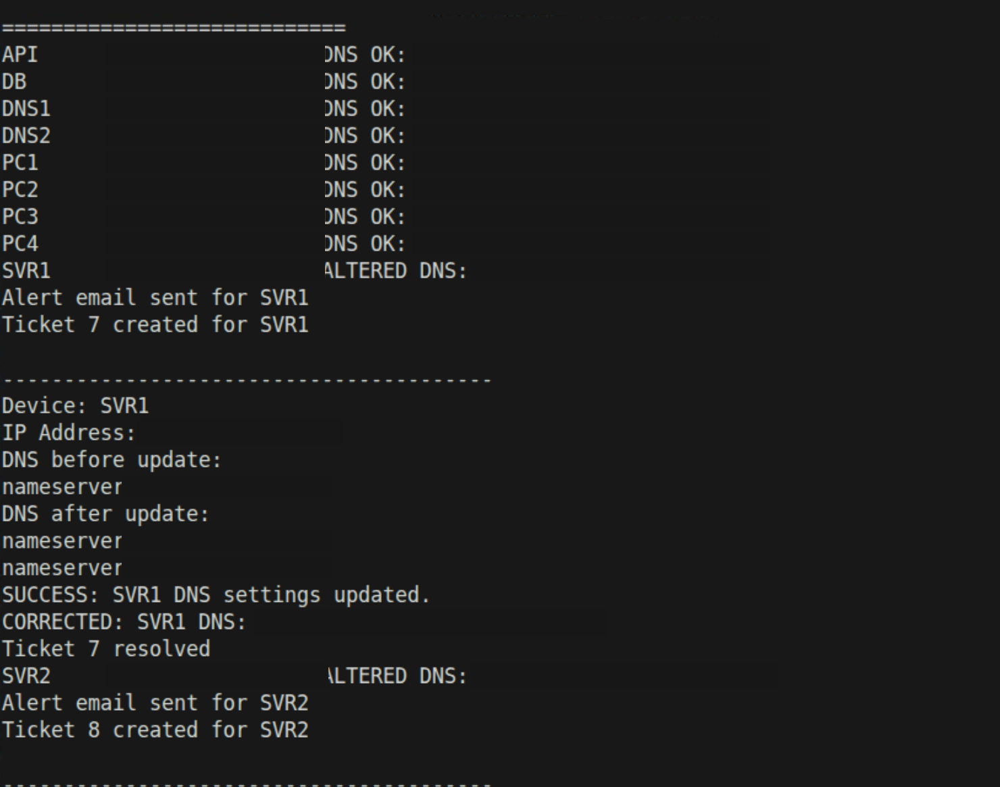

# DNS Configuration Monitoring and Recovery

**Python · DNS configuration drift · Linux service recovery**

This started as a DNS troubleshooting and recovery exercise. I compared the resolvers configured on lab machines with the expected settings, generated alerts and help-desk tickets when they drifted, and verified the settings after correcting the affected systems. I also backed up the DNS server configuration and recovered an inactive DNS service over SSH.

I separated the DNS work from the general device-availability monitor because the failure and recovery criteria are different. A server that responds to ping can still have the wrong resolvers. A missing DNS observation isn't evidence that the configuration is healthy, and recovery should only be recorded after a confirmed matching result.

The public implementation replays recorded DNS observations and tracks those changes without accessing the original lab. A separate, explicitly confirmed SSH utility demonstrates guarded service checks and DNS-zone backups, with strict SSH host-key validation. **The revised SSH utility has not been tested against a real DNS server.** It does not silently rewrite clients' resolver files, send mail or open tickets.

## Original lab evidence



The screenshot is a cropped historical lab capture with student/project identifiers and unrelated interface elements removed. Classroom-only lab addresses remain visible. The published example data and zone records are synthetic, using addresses reserved for documentation.

## Test the logic

```bash
python run.py
python -m unittest discover -s tests -v
```

The replay opens a DNS-drift incident, preserves it across a missing observation, then resolves it when the expected resolver set is verified. The SSH utility is in `src/ssh_actions.py`; it requires `--confirm-live`, a trusted IP, SSH-key access and an existing `known_hosts` entry; backups additionally require an explicitly chosen BIND zone path. DNS-zone backups are confined to the Git-ignored `private-output/` directory. The utility rejects arbitrary and parent-traversal paths, refuses overwrites, and creates files with owner-only permissions.

This public version was adapted from the original lab with AI assistance and tested against local simulations and mocked SSH calls, not production equipment.
